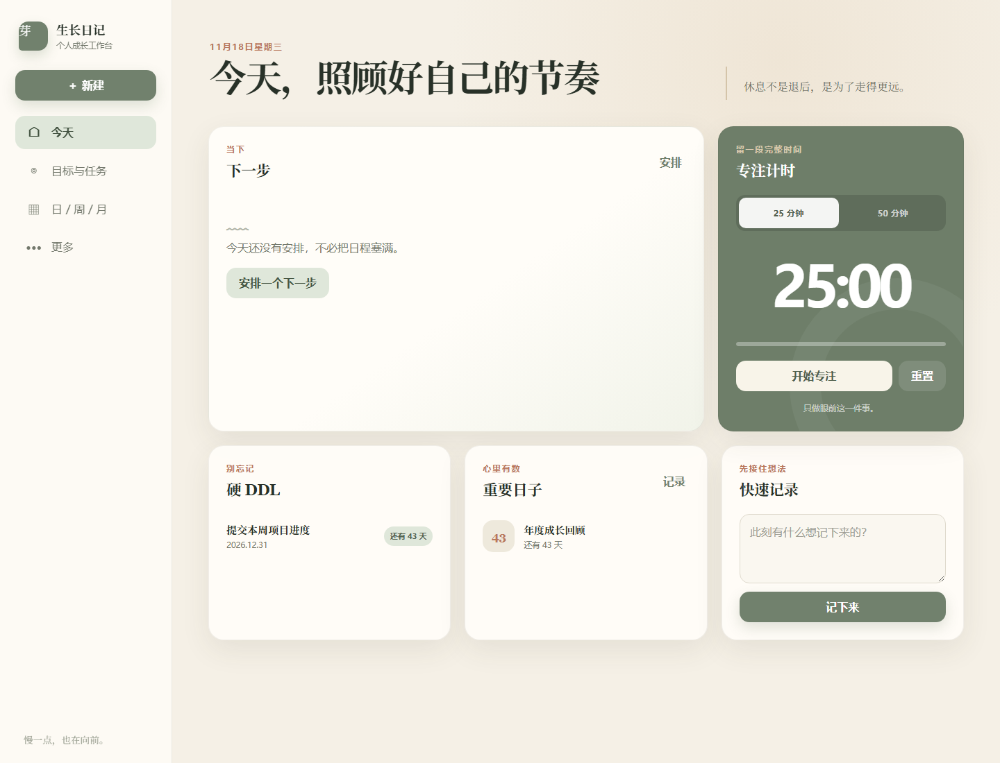

# 生长日记 · 个人成长工作台

> 把一个大方向拆成「下一件事」；把今天安排好；把重要日子记牢。
> 整个工作台只有一个 HTML 文件：**不用安装、不用注册、不用联网，双击就能用**。
>
> 单文件 · 零依赖 · 离线可用 · MIT

**[▶ 在线体验](https://hexiaobing034-lang.github.io/personal-growth-workbench/)** ｜ [本地使用方法](使用说明.md) ｜ [更新记录](CHANGELOG.md)



---

## 这是什么

「生长日记」是一个给自己用的成长工作台。它想解决的不是「如何更高效」，而是**如何不被效率工具本身拖住**：

- 打开只有一个问题：**下一步是什么？** 而不是一堆待办和红点。
- 目标不写成一长串清单，而是「目标 → 里程碑 → 行动」三层，进度自动算出来。
- 重要日期（硬 DDL、想完成的目标日）单独成栏，用剩余天数说话。
- 想到什么先丢进收件箱，不打断当下的事。
- 专注计时只留 25 / 50 分钟两档，一个按钮开始。

所有数据只存在**你自己的浏览器里**，没有账号、没有服务器、没有埋点。

## 功能

### 今天
- **下一步**：把「安排在今天」的行动与任务挑出来，按优先级排序，最多 5 条，勾掉即可。
- **专注计时**：25 分钟与 50 分钟两档，开始 / 暂停 / 重置，结束时可选提示音。
- **硬 DDL**：按剩余天数排序，逾期 / 今天到期 / 临近都有颜色区分。
- **重要日子**：倒计时卡片，可写备注。
- **快速记录**：随手写一句，先存进收件箱。

### 目标与任务
- 三层结构：**目标 → 里程碑 → 行动**，里程碑显示「已完成 x/y 个行动 · z%」。
- 独立任务：不必塞进目标的小事，也有自己的位置。
- 每条任务支持优先级（高 / 中 / 低）、分类、备注、安排日。
- 截止日支持「硬 DDL」与「目标日」两种语义。

### 日 / 周 / 月
- 同一份任务，切换三种视角看：某一天要做什么、这一周的节奏、这一个月的分布。

### 更多
- 灵感收件箱：整理、归档随手记。
- 重要日期管理：新增、编辑、删除。
- **数据备份**：一键导出 JSON 备份，也可以导入恢复；导入前会做完整校验，坏文件不会覆盖原有数据。
- 本地数据异常时进入「恢复页」：先导出原始数据，再导入有效备份或明确丢弃。
- 提示音开关。

## 怎么用

### 在线使用
打开 **[hexiaobing034-lang.github.io/personal-growth-workbench](https://hexiaobing034-lang.github.io/personal-growth-workbench/)** 即可。

### 本地使用（推荐，数据完全属于你）
1. 下载本仓库（`Code → Download ZIP`，或 `git clone`）。
2. 双击 `index.html`。

不需要 Node.js、不需要 `npm install`、不需要任何构建步骤。

> 数据保存在「当前浏览器 + 当前文件来源」下。移动或重命名 HTML 文件后，部分浏览器会把它视为新的本地来源，
> 看到空数据时请用「更多 → 导入备份」恢复。建议定期导出备份。

## 数据与隐私

- 存储位置：浏览器 `localStorage`，键名 `personal-growth-workbench:v1`。
- 首次打开会写入几条示例数据（目标、里程碑、行动、独立任务、随手记、倒计时各一条），方便理解结构；删掉即可。
- 不发起任何网络请求：没有 CDN、没有字体外链、没有统计脚本。断网也能用。
- 本仓库不含任何真实个人数据；所有示例都是虚构的。

## 技术说明

- 单文件实现：HTML + 内联 CSS + 内联 JS（约 130 KB），无框架、无构建、无依赖。
- 状态经过 schema 校验后才写入与渲染；导入备份同样先校验再替换，失败时保留原数据。
- `localStorage` 不可用（隐私模式、配额满）时会降级并在界面上提示，不会静默丢数据。
- 无障碍：语义化标签、`aria-current` / `aria-pressed`、键盘可达、`prefers-reduced-motion` 适配。

## 目录结构

```
personal-growth-workbench/
├── index.html            # 应用本体（全部代码都在这里）
├── README.md
├── 使用说明.md            # 本地使用与备份说明
├── CHANGELOG.md
├── LICENSE               # MIT
└── docs/
    └── preview.png       # 界面截图
```

## 开发与更新

源码在本地一处维护，仓库里是发布副本。同步命令（在发布工作区执行）：

```powershell
.\scripts\sync-growth-workbench.ps1 -Message "feat: 更新 xxx" -Push
```

## 已知限制

- 数据只与「浏览器 + 文件来源」绑定，不跨设备同步 —— 换设备请用导出的 JSON 备份。
- 没有后端，也没有多人协作；这是刻意的取舍。
- 打印与导出图片暂未支持。

## License

[MIT](LICENSE) © 2026 何幸冰
